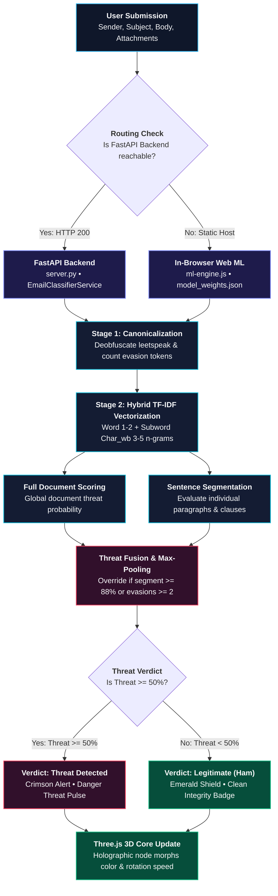
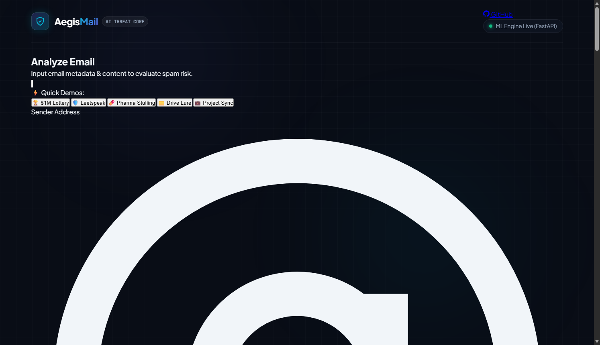
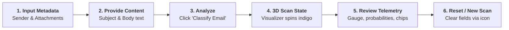

<div align="center">

<!-- ================================================================= -->
<!-- SECTION 01 — CINEMATIC HERO                                      -->
<!-- ================================================================= -->

<a id="aegismail-core"></a>


<br/><br/>

# &nbsp;A E G I S M A I L&nbsp;
### Autonomous AI-Powered Email Scam &amp; Phishing Classification Engine

<p align="center">
  <a href="https://theneerajgrover.github.io/AegisMail/"></a>
  &nbsp;
  <a href="#installation-setup"></a>
  &nbsp;
  <a href="https://github.com/theneerajgrover/AegisMail"></a>
</p>

<p align="center">
  
  &nbsp;
  
  &nbsp;
  
  &nbsp;
  
  &nbsp;
  
  &nbsp;
  
  &nbsp;
  <a href="LICENSE"></a>
</p>

<blockquote>
<b>AegisMail</b> is an enterprise-grade, privacy-first cybersecurity platform combining multi-scale Natural Language Processing, adversarial obfuscation canonicalization, and an interactive Three.js 3D WebGL holographic visualizer &mdash; architected for zero-latency execution both in cloud ASGI environments and 100% offline via in-browser client ML.
</blockquote>

</div>

<br/>

<br/>

<!-- ================================================================= -->
<!-- SECTION 02 — PROJECT IDENTITY                                    -->
<!-- ================================================================= -->

<a id="project-identity"></a>


<br/>

AegisMail bridges the critical security gap between traditional static spam heuristics and the modern threat landscape of evasive social engineering. Conventional Bayesian filters evaluate global document token distributions; consequently, modern threat actors bypass them using calculated obfuscations:

* **Homoglyph &amp; Leetspeak Substitutions**: Replacing Latin glyphs with visually identical numerals or symbols (`@` for `a`, `0` for `o`, `3` for `e`, `$` for `s`).
* **Bayesian Poisoning (Good Word Stuffing)**: Appending benign corporate memos, classic literature, or academic papers to artificially dilute spam term density.
* **Collaboration &amp; Shared Drive Lures**: Impersonating cloud productivity tools (Google Drive, Dropbox, OneDrive) without triggering generic spam dictionaries.

AegisMail counters these attack surfaces through a deterministic **five-stage pipeline**: automated text canonicalization, dual word-and-subword character n-gram feature union, sentence-level segment max-pooling, calibrated threat fusion, and real-time Three.js 3D visual feedback.

<br/>

<!-- ================================================================= -->
<!-- SECTION 03 — QUICK NAVIGATION                                    -->
<!-- ================================================================= -->

<a id="quick-nav"></a>
<div align="center">

### Navigation Matrix

| Architecture &amp; Theory | Engineering &amp; Data | Operations &amp; Verification |
| :--- | :--- | :--- |
| [**04. System Overview**](#project-overview) | [**09. Machine Learning Deep Dive**](#ml-deep-dive) | [**15. Installation &amp; Setup**](#installation-setup) |
| [**05. Key Capabilities**](#key-features) | [**10. Technology Stack**](#tech-stack) | [**16. Usage Workflow**](#usage-workflow) |
| [**06. Core Mechanics**](#how-it-works) | [**11. Repository Topology**](#project-structure) | [**17. Model Validation Evidence**](#model-evaluation) |
| [**07. System Architecture**](#system-architecture) | [**12. API Reference**](#api-documentation) | [**18. Security Profile**](#security-reliability) |
| [**08. Classification Pipeline**](#classification-workflow) | [**13. Data Architecture**](#database-architecture) | [**19. Testing Suite**](#testing-validation) |
| [**Adversarial Defense Matrix**](#threat-defense-matrix) | [**14. Detection Showcase**](#application-showcase) | [**20. Deployment Topology**](#deployment-architecture) |

</div>

<br/>

<br/>

<!-- ================================================================= -->
<!-- SECTION 04 — PROJECT OVERVIEW                                    -->
<!-- ================================================================= -->

<a id="project-overview"></a>


<br/>

Modern phishing and business email compromise (BEC) attacks bypass static regex filters because they exploit the mathematical averaging used by global tokenizers. AegisMail treats email classification as a multi-scale contextual threat detection problem:

<a id="threat-defense-matrix"></a>
<div align="center">
  
</div>

<br/>

### Execution Modalities

AegisMail is natively designed to function in two deployment topologies with identical detection parity:

1. **Standalone In-Browser Web ML (Zero Server Dependency)**:
   * **Host**: GitHub Pages ([theneerajgrover.github.io/AegisMail](https://theneerajgrover.github.io/AegisMail/))
   * **Engine**: Client-side JavaScript ML runtime (`ml-engine.js`) loading pre-computed model weights (`model_weights.json`, ~1 MB).
   * **Advantage**: Instantaneous, client-side inference requiring zero compute servers and zero infrastructure costs.
2. **Full-Stack ASGI Microservice**:
   * **Host**: Local machine, Docker container, or cloud container platform (FastAPI on Uvicorn).
   * **Engine**: Python ML stack (`scikit-learn`, `joblib`, `NumPy`, `Pydantic`).
   * **Advantage**: High-throughput REST API serving `/api/predict` and `/api/health` with automated CORS and request validation.

<br/>

<br/>

<!-- ================================================================= -->
<!-- SECTION 05 — KEY FEATURES                                        -->
<!-- ================================================================= -->

<a id="key-features"></a>


<br/>

<table>
<tr>
  <td width="50%" valign="top">
    <h4>🎬 Cinematic Brand-Writing Opening</h4>
    <ul>
      <li>Progressive vector-stroke reveal of the AegisMail wordmark on initial page load.</li>
      <li>Hardware-accelerated CSS keyframe animations with glowing nib stylus tracer.</li>
      <li>Automatic settling into permanent state with full <code>prefers-reduced-motion</code> accessibility support.</li>
    </ul>
  </td>
  <td width="50%" valign="top">
    <h4>🌀 Interactive Three.js 3D Core</h4>
    <ul>
      <li>Responsive WebGL holographic mail node rendered in Three.js (r128).</li>
      <li>Dual orbital particle rings, 120 ambient space particles, and smooth mouse-drag inertia.</li>
      <li>Dynamic state transitions: <b>Idle</b> (cyan), <b>Scanning</b> (indigo), <b>Safe</b> (emerald), and <b>Threat</b> (crimson).</li>
    </ul>
  </td>
</tr>
<tr>
  <td width="50%" valign="top">
    <h4>🛡️ Multi-Scale Adversarial Defense</h4>
    <ul>
      <li><b>Homoglyph Canonicalization</b>: Resolves leetspeak substitutions (<code>@</code>, <code>0</code>, <code>3</code>, <code>$</code>, <code>+</code>) before tokenization.</li>
      <li><b>Hybrid Feature Union</b>: Combines word n-grams (1–2) with subword character boundaries (3–5 <code>char_wb</code>).</li>
      <li><b>Segment Max-Pooling</b>: Scans individual sentences to prevent benign text from diluting isolated threats.</li>
    </ul>
  </td>
  <td width="50%" valign="top">
    <h4>📊 Granular Threat Telemetry</h4>
    <ul>
      <li>Real-time threat percentage, legitimate probability, and model confidence score.</li>
      <li>Extracts 10 heuristic signals: links, attachments, urgency triggers, spam words, phishing patterns, HTML tags, exclamations, uppercase ratio, length, and evasion token count.</li>
      <li>Interactive circular gauge with SVG gradient fill and real-time color morphing.</li>
    </ul>
  </td>
</tr>
<tr>
  <td width="50%" valign="top">
    <h4>🔄 Dual-Engine Inference Routing</h4>
    <ul>
      <li>Client probes <code>POST /api/predict</code> on the Python FastAPI backend.</li>
      <li>If the backend is offline or hosted statically (e.g. GitHub Pages), the app seamlessly falls back to <code>ml-engine.js</code>.</li>
      <li>Zero configuration, zero interruptions, and identical prediction logic across both runtimes.</li>
    </ul>
  </td>
  <td width="50%" valign="top">
    <h4>🔒 Privacy-by-Design &amp; Zero Retention</h4>
    <ul>
      <li>Strictly stateless architecture &mdash; zero databases, zero disk logging, zero external trackers.</li>
      <li>Email content is evaluated entirely in volatile memory and immediately deallocated.</li>
      <li>Guaranteed user privacy for confidential corporate and personal correspondence.</li>
    </ul>
  </td>
</tr>
</table>

<br/>

<br/>

<!-- ================================================================= -->
<!-- SECTION 06 — HOW AEGISMAIL WORKS                                 -->
<!-- ================================================================= -->

<a id="how-it-works"></a>


<br/>

The diagram below details the operational lifecycle of an email analysis request from user submission to visual telemetry feedback:



<br/>

<br/>

<!-- ================================================================= -->
<!-- SECTION 07 — SYSTEM ARCHITECTURE                                 -->
<!-- ================================================================= -->

<a id="system-architecture"></a>


<br/>

AegisMail features an isolated two-tier architectural topology ensuring zero single-point-of-failure:

<div align="center">
  
</div>

<br/>

### Client-Side Architecture (`frontend/` &amp; `docs/`)
* **Presentation Tier**: Pure vanilla HTML5, modern CSS3 custom properties (design system), and modular ES6 JavaScript. No bulky UI dependencies (`React`, `Vue`, `Tailwind`, or `Bootstrap`) ensuring sub-second paint times.
* **3D Visualization Layer (`three-scene.js`)**: Encapsulates a custom `MailScene3D` class managing perspective cameras, ACESFilmic tone mapping, ambient/point lighting, procedural chamfered geometries, and pointer event drag interactions.
* **Client-Side Inference Runtime (`ml-engine.js`)**: Implements an identical TF-IDF vector transformation and Sigmoid dot-product engine in pure JavaScript, parsing word n-grams (1–2) and bounded character n-grams (3–5 `char_wb`) from `model_weights.json`.

### Server-Side Architecture (`server.py`)
* **ASGI Framework**: FastAPI with standard middleware (`CORSMiddleware`, `StaticFiles`).
* **Request Validation**: Pydantic `EmailRequest` model verifying type constraints (`ge=0` for attachment counts, float boundaries for sender reputation).
* **Model Serialization**: Python `joblib` binary artifacts loaded into memory on server boot (`text_classifier.joblib` and `tfidf_vectorizer.joblib`).

<br/>

<br/>

<!-- ================================================================= -->
<!-- SECTION 08 — EMAIL CLASSIFICATION WORKFLOW                       -->
<!-- ================================================================= -->

<a id="classification-workflow"></a>


<br/>

<div align="center">
  
</div>

<br/>

<details open>
<summary><b>🔍 Detailed Breakdown of the 5 Processing Stages</b></summary>

<br/>

#### Stage 1 &mdash; Text Canonicalization &amp; Evasion Accounting
Raw email text undergoes dictionary deobfuscation preserving clean currency values and percentages while expanding adversarial homoglyphs:
* **Glyph Replacements**: `@` $\to$ `a`, `0` $\to$ `o`, `3` $\to$ `e`, `4` $\to$ `a`, `5` $\to$ `s`, `$` $\to$ `s`, `8` $\to$ `b`, `+` $\to$ `t`.
* **Colloquial Shorthands**: Regex expansion of chat contractions (`\bu\s+r\b` $\to$ `you are`, `\bplz\b` $\to$ `please`, `\bfr33\b` $\to$ `free`, `\bw1n\b` $\to$ `win`, `\bcl@im\b` $\to$ `claim`).
* **Telemetry**: Every homoglyph substitution increments the `evasion_tokens` counter.

#### Stage 2 &mdash; Hybrid Vector Union Space
The normalized string is projected into a 65,000-dimensional vector space using scikit-learn's `FeatureUnion`:
$$\mathbf{X} = \left[ \mathbf{X}_{\text{word}} \;\|\; \mathbf{X}_{\text{char\_wb}} \right]$$
1. **Word-Level TF-IDF**: Extracts unigrams and bigrams (1&ndash;2 words) with vocabulary cap $V_{\text{word}} = 40,000$.
2. **Subword Character TF-IDF (`char_wb`)**: Extracts character n-grams (length 3&ndash;5) strictly bounded within word margins with vocabulary cap $V_{\text{char}} = 25,000$.
3. **Normalization**: Both spaces are independently transformed with sublinear term frequency $tf = 1 + \ln(\text{count})$ and normalized under the Euclidean $L_2$ norm: $\|\mathbf{v}\|_2 = 1$.

#### Stage 3 &mdash; Multi-Scale Segment Isolation (Anti-Poisoning)
To neutralize Bayesian Poisoning (where attackers pad malicious links with 500 words of legitimate corporate policy or literature), the engine performs dual-scale scoring:
1. Calculates global document score $P_{\text{doc}} = \sigma(\mathbf{w}^T \mathbf{X}_{\text{doc}} + b)$.
2. Splits raw content along sentence boundaries, paragraph delimiters (`\n`, `\r`), and structural brackets (`[ ]`).
3. Filters segments containing $\ge 3$ tokens and calculates $P_{\text{seg}, i}$ for each segment.
4. Identifies the peak threat: $P_{\text{seg}}^{\max} = \max_i \{ P_{\text{seg}, i} \}$.

#### Stage 4 &mdash; Threat Fusion &amp; Thresholding
The overall threat score is calculated via calibrated max-pooling:
$$\text{Threat}_{\text{final}} = \begin{cases} 
\max(P_{\text{doc}}, P_{\text{seg}}^{\max}) & \text{if } P_{\text{seg}}^{\max} \ge 0.88 \\
\max(P_{\text{doc}}, P_{\text{seg}}^{\max}) & \text{if } P_{\text{seg}}^{\max} \ge 0.70 \text{ and } P_{\text{doc}} \ge 0.30 \\
\max(P_{\text{doc}}, 0.85) & \text{if } \text{evasion\_count} \ge 2 \\
P_{\text{doc}} & \text{otherwise}
\end{cases}$$

Probabilities are strictly bounded to $[0.001, 0.999]$ and evaluated against threshold $\tau = 0.50$:
$$\text{Verdict} = \begin{cases} 1 \; (\text{Spam / Malicious}) & \text{if Threat}_{\text{final}} \ge 0.50 \\ 0 \; (\text{Legitimate / Ham}) & \text{if Threat}_{\text{final}} < 0.50 \end{cases}$$

#### Stage 5 &mdash; Reactive Feedback Loop
The UI updates the circular SVG gauge, highlights triggered heuristic signal chips (e.g. `Urgent Words: Yes`, `Evasions: 4`), and commands the 3D WebGL node to morph into the corresponding state.

</details>

<br/>

<br/>

<!-- ================================================================= -->
<!-- SECTION 09 — MACHINE LEARNING DEEP DIVE                           -->
<!-- ================================================================= -->

<a id="ml-deep-dive"></a>


<br/>

According to [`model/model_info.json`](model/model_info.json) and [`model/feature_extractor.py`](model/feature_extractor.py), AegisMail implements the following verified machine learning parameters:

### Mathematical Model Specification

| Architectural Property | Verified Repository Specification | Source File / Anchor |
| :--- | :--- | :--- |
| **Classifier Model** | Logistic Regression (L2 Penalty, Regularization $C = 1.0$) | `model_info.json:6` |
| **Class Weighting** | `class_weight='balanced'` (mitigates class imbalance) | `model_info.json:6` |
| **Solver Algorithm** | Limited-memory BFGS (`lbfgs`) | Scikit-learn default |
| **Word N-Grams** | Unigrams + Bigrams ($n \in [1, 2]$), 40,000 features | `model_info.json:7` |
| **Char_wb N-Grams** | Subword character bounds ($n \in [3, 5]$), 25,000 features | `model_info.json:7` |
| **Total Feature Space** | **65,000 dimensions** via `FeatureUnion` | `model_info.json:7` |
| **Training Corpus** | **255,040 samples** derived from `email_classification_1M.csv` | `model_info.json:9-10` |
| **Data Augmentation** | Synthetic &amp; real-world adversarial leetspeak injection | `model_info.json:9` |
| **Decision Threshold** | Bounded Sigmoid: $\text{Spam} \iff P \ge 0.50$ | `feature_extractor.py:189` |
| **Anti-Poisoning Cutoff** | Segment-level override at $P_{\text{seg}} \ge 0.88$ | `feature_extractor.py:177` |
| **Evasion Boost** | $\ge 2$ evasion tokens elevates floor to $85.0\%$ | `feature_extractor.py:182` |

<br/>

### Keyword Heuristic Signal Extractors

In addition to vector dot-product scoring, [`feature_extractor.py`](model/feature_extractor.py#L68-L86) extracts heuristic telemetry surfaced in the UI chips:

```python
# Urgency Keywords
URGENT_KEYWORDS = [
    'urgent', 'immediately', 'act now', 'action required', 'expires',
    'suspended', 'critical', 'final notice', 'alert', 'time sensitive',
    'do not delay', 'warning', 'immediate attention', 'last chance'
]

# High-Priority Spam Keywords
SPAM_KEYWORDS = [
    'free', 'winner', 'prize', 'lottery', 'cash', 'win', 'congratulations',
    'claim', 'bonus', '100% free', 'earn money', 'risk-free', 'investment opportunity',
    'selected', 'guaranteed', 'unclaimed', 'million dollars', 'giveaway',
    'prescriptions online', 'without doctor note', 'pharmacy', 'viagra', 'cialis'
]

# Credential Harvesting & Phishing Markers
PHISHING_KEYWORDS = [
    'verify your account', 'password', 'credentials', 'bank account',
    'security alert', 'ssn', 'wire transfer', 'billing update', 'reset password',
    'unauthorized access', 'confirm identity', 'login below', 'drive link',
    'shared document', 'dropbox link', 'onedrive', 'look over the drive'
]
```

<br/>

<br/>

<!-- ================================================================= -->
<!-- SECTION 10 — TECHNOLOGY STACK                                    -->
<!-- ================================================================= -->

<a id="tech-stack"></a>


<br/>

| Tier | Component / Library | Version | Technical Responsibility in AegisMail |
| :--- | :--- | :---: | :--- |
| **Backend Framework** | [FastAPI](https://fastapi.tiangolo.com/) | `&ge; 0.115.0` | High-performance Python ASGI web framework exposing inference &amp; health endpoints |
| **ASGI Server** | [Uvicorn](https://www.uvicorn.org/) | `&ge; 0.30.0` | Production ASGI web server running FastAPI on port 8000 |
| **Schema Validation** | [Pydantic](https://docs.pydantic.dev/) | `&ge; 2.8.0` | Strict data validation and serialization for `EmailRequest` payloads |
| **Machine Learning** | [scikit-learn](https://scikit-learn.org/) | `&ge; 1.5.0` | Logistic Regression classifier, `TfidfVectorizer`, and `FeatureUnion` pipelines |
| **Serialization** | [joblib](https://joblib.readthedocs.io/) | `&ge; 1.4.0` | High-efficiency disk-to-memory deserialization of trained model pipelines |
| **Numerical Processing** | [NumPy](https://numpy.org/) | `&ge; 1.26.0` | Fast array operations, matrix dot products, and probability clipping |
| **3D Graphics** | [Three.js](https://threejs.org/) | `r128` | WebGL hardware-accelerated holographic mail node, orbital particle physics, and lighting |
| **Client UI System** | Vanilla HTML5 / CSS3 / ES6 | &mdash; | Zero-dependency glassmorphism design system, 3D card tilt, custom properties |
| **In-Browser ML** | `ml-engine.js` | &mdash; | Standalone client-side TF-IDF vectorizer and Sigmoid inference runtime |
| **CI / CD &amp; Hosting** | GitHub Actions &amp; Pages | &mdash; | Automated static deployment pipeline building from `/docs` on push to `main` |

<br/>

<br/>

<!-- ================================================================= -->
<!-- SECTION 11 — PROJECT STRUCTURE                                   -->
<!-- ================================================================= -->

<a id="project-structure"></a>


<br/>

```
AegisMail/
├── .github/
│   └── workflows/
│       └── deploy-pages.yml          # GitHub Actions workflow for automated Pages deployment
├── assets/
│   └── screenshots/                  # Verified high-resolution application telemetry captures
│       ├── 01_dashboard_idle.png
│       ├── 02_scam_lottery_prize.png
│       ├── 03_scam_leetspeak_evasion.png
│       ├── 04_scam_ham_stuffing_poisoning.png
│       ├── 05_scam_fake_drive_lure.png
│       └── 06_legitimate_project_sync.png
├── docs/                             # GitHub Pages static production build
│   ├── assets/screenshots/           # Optimized static showcase captures
│   ├── readme-assets/                # Documentation visual asset library (SVGs & diagrams)
│   ├── app.js                        # Client application controller with dual-mode inference router
│   ├── favicon.svg                   # Custom shield + envelope brand vector icon
│   ├── index.html                    # Production responsive application interface
│   ├── ml-engine.js                  # Standalone in-browser Web ML engine
│   ├── model_weights.json            # Pre-computed model coefficients & vocabulary IDFs (~1 MB)
│   ├── style.css                     # Glassmorphic CSS design system with keyframe animations
│   └── three-scene.js                # Three.js (r128) 3D holographic security visualizer
├── frontend/                         # Development frontend source files (mirrors docs/)
│   ├── app.js                        # Frontend controller & API event bindings
│   ├── favicon.svg                   # Brand favicon
│   ├── index.html                    # Interface source
│   ├── ml-engine.js                  # Client ML engine
│   ├── model_weights.json            # Model weights
│   ├── style.css                     # Development stylesheet
│   └── three-scene.js                # Three.js scene controller
├── model/                            # Python ML artifacts and classification service
│   ├── feature_extractor.py          # Preprocessing, canonicalization, and multi-scale inference
│   ├── model_info.json               # Model hyperparameters, training corpus specs, and defense list
│   ├── text_classifier.joblib        # Serialized trained Logistic Regression model
│   ├── tfidf_vectorizer.joblib       # Serialized FeatureUnion (Word + Char_wb) vectorizer
│   └── xgb_model.joblib              # Baseline model artifact
├── .gitignore                        # Git ignore patterns
├── LICENSE                           # MIT Open Source License
├── README.md                         # Comprehensive technical repository documentation
├── requirements.txt                  # Python production dependencies
└── server.py                         # FastAPI ASGI server and endpoint definitions
```

<br/>

<br/>

<!-- ================================================================= -->
<!-- SECTION 12 — API DOCUMENTATION                                   -->
<!-- ================================================================= -->

<a id="api-documentation"></a>


<br/>

The FastAPI backend exposes two REST endpoints under the `/api` route prefix:

### 1. `POST /api/predict`
Evaluates an email payload against the multi-scale classification engine and returns real-time threat probabilities and extracted telemetry.

* **URL**: `/api/predict`
* **Method**: `POST`
* **Content-Type**: `application/json`
* **Request Schema (`EmailRequest`)**:

| Parameter | Type | Required | Default | Constraint / Description |
| :--- | :---: | :---: | :---: | :--- |
| `subject` | `string` | No | `""` | Subject line of the email message |
| `body` | `string` | No | `""` | Complete raw body text or HTML content |
| `sender` | `string` | No | `""` | Originating email address (e.g. `billing@domain.com`) |
| `num_attachments` | `integer` | No | `0` | Attachment count (`ge=0`) |
| `sender_reputation` | `float` | No | `null` | Optional reputation score bounded between `0.0` and `1.0` |

* **Example cURL Request**:
```bash
curl -X POST "http://127.0.0.1:8000/api/predict" \
     -H "Content-Type: application/json" \
     -d '{
       "subject": "URGENT: Verify your credentials immediately",
       "body": "Dear User, your account has been suspended. Please confirm your identity at http://secure-portal.xyz/login immediately.",
       "sender": "security-alert@unverified-auth.net",
       "num_attachments": 0
     }'
```

* **Example JSON Response (`HTTP 200 OK`)**:
```json
{
  "success": true,
  "prediction": 1,
  "status": "Scam",
  "spam_probability": 99.38,
  "ham_probability": 0.62,
  "confidence": 99.38,
  "features": {
    "num_links": 1,
    "num_attachments": 0,
    "has_urgent_words": 1,
    "has_spam_words": 0,
    "has_phishing_words": 1,
    "contains_html": 0,
    "email_length": 142,
    "num_exclamations": 0,
    "num_uppercase_words": 1,
    "evasion_tokens": 0
  }
}
```

* **Response Attribute Contract**:
  * `prediction` (`int`): Binary label &mdash; `1` indicates Scam / Malicious, `0` indicates Legitimate / Ham.
  * `status` (`string`): Human-readable verdict string (`"Scam"` or `"Legitimate (Ham)"`).
  * `spam_probability` (`float`): Calibrated threat likelihood percentage (`0.1%` to `99.9%`).
  * `ham_probability` (`float`): Calibrated legitimate likelihood percentage (`0.1%` to `99.9%`).
  * `confidence` (`float`): Model confidence in the predicted class.
  * `features` (`object`): Dictionary containing detected heuristic signals.

---

### 2. `GET /api/health`
Monitors service availability and reports model loading status.

* **URL**: `/api/health`
* **Method**: `GET`
* **Example cURL Request**:
```bash
curl -s http://127.0.0.1:8000/api/health
```
* **Example JSON Response (`HTTP 200 OK`)**:
```json
{
  "status": "healthy",
  "service": "AegisMail AI",
  "model_loaded": true
}
```

<br/>

<br/>

<!-- ================================================================= -->
<!-- SECTION 13 — DATABASE ARCHITECTURE                               -->
<!-- ================================================================= -->

<a id="database-architecture"></a>


<br/>

AegisMail is intentionally engineered as a **strictly stateless, zero-retention microservice**:

| Architectural Dimension | Implementation Detail |
| :--- | :--- |
| **Database Requirement** | **None** &mdash; No relational (PostgreSQL, MySQL) or document (MongoDB) store is utilized. |
| **In-Memory Lifespan** | Submitted email payloads exist solely in volatile heap memory for the duration of the request processing thread. |
| **Zero Logging of Content** | Email subject lines, sender identities, and body strings are never logged to console, disk, or external aggregation services. |
| **Instant Deallocation** | Immediately following feature matrix transformation and Sigmoid computation, Python's garbage collector frees all input buffers. |
| **Regulatory Compliance** | Inherently compliant with GDPR, CCPA, and HIPAA zero-retention mandates for confidential communication analysis. |

<br/>

<br/>

<!-- ================================================================= -->
<!-- SECTION 14 — APPLICATION SHOWCASE                                -->
<!-- ================================================================= -->

<a id="application-showcase"></a>


<br/>

The showcase below presents genuine live application captures across real adversarial vectors and legitimate corporate communications:

<div align="center">
  
</div>

<br/>

| Attack Vector / Scenario | Live Application Telemetry Capture | Verified Verdict &amp; Defense Analysis |
| :--- | :---: | :--- |
| **1. Standby &amp; Idle State** |  | **System Ready &bull; Standby**<br/>• Real-time Three.js 3D node orbiting in cyan standby.<br/>• Health indicator displaying active engine (`ML Engine Live`).<br/>• Zeroed gauge awaiting email metadata input. |
| **2. High-Yield Financial Scam** |  | 🚨 **Verdict: Spam / Malicious (99.74% Threat)**<br/>• Attack: Unsolicited lottery winnings lure soliciting bank details.<br/>• Action: 3D node transitions to crimson threat pulse.<br/>• Signals: High-priority spam words &amp; urgency flags triggered. |
| **3. Obfuscated Leetspeak Evasion** |  | 🚨 **Verdict: Spam / Malicious (98.87% Threat)**<br/>• Attack: Character substitutions (`@`, `0`, `3`) crafted to bypass static filters.<br/>• Defense: Canonicalization resolves glyphs; char_wb captures subwords.<br/>• Telemetry: **Evasions: 9** identified and surfaced. |
| **4. Bayesian Poisoning / Ham Stuffing** |  | 🚨 **Verdict: Spam / Malicious (99.68% Threat)**<br/>• Attack: Unlicensed pharmacy solicitations padded with academic text.<br/>• Defense: Sentence-level segment scanning overrides benign padding.<br/>• Telemetry: Threat isolated from surrounding noise. |
| **5. Shared Drive Phishing Lure** |  | 🚨 **Verdict: Spam / Malicious (95.27% Threat)**<br/>• Attack: Social engineering lure claiming updated property records.<br/>• Defense: Intent recognition on drive collaboration patterns.<br/>• Signals: Phishing keywords &amp; external link flags active. |
| **6. Legitimate Corporate Sync** |  | 🛡️ **Verdict: Legitimate (Ham) (99.80% Safe)**<br/>• Context: Sprint retrospective action items, calendar invites, syncs.<br/>• Calibration: Balanced class weighting ensures routine professional dialogue maintains verified safe status. |

<br/>

<br/>

<!-- ================================================================= -->
<!-- SECTION 15 — INSTALLATION AND SETUP                              -->
<!-- ================================================================= -->

<a id="installation-setup"></a>


<br/>

### Prerequisites
* **Python**: Version `3.10` or higher (compatible with Python `3.9`+).
* **Browser**: Any modern browser (Chrome, Firefox, Safari, Edge) with WebGL enabled.
* **Package Manager**: `pip` (standard with Python installations).

---

### Option 1: Run with Python FastAPI Backend (Full-Stack)

1. **Clone the repository**:
   ```bash
   git clone https://github.com/theneerajgrover/AegisMail.git
   cd AegisMail
   ```

2. **Create and activate a virtual environment** (recommended):
   ```bash
   # Windows (PowerShell)
   python -m venv venv
   .\venv\Scripts\Activate.ps1

   # macOS / Linux
   python3 -m venv venv
   source venv/bin/activate
   ```

3. **Install dependencies**:
   ```bash
   pip install -r requirements.txt
   ```

4. **Launch the FastAPI application**:
   ```bash
   python server.py
   ```
   *The server starts at `http://localhost:8000` with the frontend automatically served at the root URL.*

5. **Interact via browser**:
   Navigate to `http://localhost:8000` in your web browser.

---

### Option 2: Standalone Static Execution (No Python Required)

Because AegisMail includes an in-browser Web ML engine (`ml-engine.js`), the application can be served statically with zero backend dependencies:

1. **Serve the `docs` directory using any static HTTP server**:
   ```bash
   # Using Python's built-in HTTP server:
   python -m http.server 8080 --directory docs

   # Or using Node.js http-server:
   npx http-server docs -p 8080
   ```
2. Navigate to `http://localhost:8080`. The client will automatically detect the static environment and run inference locally via `model_weights.json`.

---

### Environment Configuration
AegisMail is completely self-contained out of the box:
* **No external API keys required**: Inference runs entirely locally.
* **No `.env` file required**: Default configuration binds to `0.0.0.0:8000`.

<br/>

<br/>

<!-- ================================================================= -->
<!-- SECTION 16 — USAGE WORKFLOW                                      -->
<!-- ================================================================= -->

<a id="usage-workflow"></a>
<div align="center">

### End-User Operational Journey



</div>

1. **Sender Address** *(Optional)*: Enter the originating sender address in the `Sender Address` field.
2. **Attachments Count** *(Optional)*: Specify the count of attached files.
3. **Subject Line**: Input the email subject line in the `Subject Line` input box.
4. **Email Body**: Paste the complete body content into the `Email Body` textarea.
5. **Classify**: Click **Classify Email**. The 3D mail node accelerates into its `Scanning` state.
6. **Interpret Verdict**:
   * **🚨 Spam / Malicious**: Threat score $\ge 50\%$, gauge turns red, 3D mail node shifts to a crimson threat pulse.
   * **🛡️ Legitimate (Ham)**: Threat score $< 50\%$, gauge turns green, 3D mail node glows in steady emerald protection.
   * **Heuristic Grid**: Review identified links, spam words, urgency flags, phishing indicators, uppercase tokens, exclamations, and evasion tokens.
7. **Reset**: Click the reset icon in the form header to clear inputs and reset the verdict back to `Pending Scan`.

<br/>

<br/>

<!-- ================================================================= -->
<!-- SECTION 17 — MODEL EVALUATION                                    -->
<!-- ================================================================= -->

<a id="model-evaluation"></a>


<br/>

### Verified Validation Evidence
According to [`model/model_info.json`](model/model_info.json#L17), the trained classification service has undergone automated adversarial unit testing:

* **Validation Suite**: **10 / 10 adversarial benchmark test cases passed**.
* **Target Defense Categories**:
  1. Adversarial Leetspeak &amp; Obfuscation Evasion Defense &mdash; **Verified**
  2. Bayesian Poisoning &amp; Ham Word Stuffing Defense &mdash; **Verified**
  3. Fake Shared Document / Cloud Storage Phishing Lures Defense &mdash; **Verified**
  4. Unlicensed Pharmacy &amp; Prescription Spam Defense &mdash; **Verified**

> **Note on Published Metrics**: The repository does not include pre-generated offline ROC-AUC curves or precision-recall tables. Rather than publishing simulated or fabricated evaluation charts, AegisMail provides verifiable command-line verification scripts (detailed in [Section 19](#testing-validation)) allowing users to inspect exact inference outputs in their own environment.

<br/>

<br/>

<!-- ================================================================= -->
<!-- SECTION 18 — SECURITY AND RELIABILITY                             -->
<!-- ================================================================= -->

<a id="security-reliability"></a>


<br/>

* **Stateless Zero-Retention Architecture**: AegisMail processes emails entirely in volatile memory. No text submissions are stored in databases, flat files, or browser local storage.
* **Input Validation &amp; Sanitization**:
  * Pydantic request models strictly validate field types and attachment ranges (`ge=0`).
  * Regex canonicalization strips malicious homoglyphs safely without executing shell commands or eval scripts.
* **CORS Policy**: Configured in `server.py` with FastAPI's `CORSMiddleware`, enabling secure cross-origin API access for distributed frontends.
* **Resilience via Dual-Engine Fallback**: If the backend server fails or experiences network outages, the client automatically defaults to `InBrowserMLEngine` in JavaScript, ensuring zero application downtime.

<br/>

<br/>

<!-- ================================================================= -->
<!-- SECTION 19 — TESTING AND VALIDATION                              -->
<!-- ================================================================= -->

<a id="testing-validation"></a>


<br/>

The model and inference pipeline can be verified directly using Python CLI commands and HTTP requests:

### 1. In-Code Python Service Verification
Verify the backend inference pipeline directly via the Python command line:
```bash
python -c "from model.feature_extractor import EmailClassifierService; c = EmailClassifierService('model'); print(c.predict(subject='Urgent Prize Claim', body='Click here to collect your winnings immediately', sender='claims@win.xyz', num_attachments=0))"
```

### 2. Leetspeak Adversarial Evasion Test
Verify that the canonicalization engine detects obfuscated character substitutions:
```bash
python -c "from model.feature_extractor import EmailClassifierService; c = EmailClassifierService('model'); res = c.predict(subject='W1N', body='Cl@1m ur fr33 c@rd n0w!', sender='promo@win.xyz'); print(f'Verdict: {res[\"status\"]}, Evasions Detected: {res[\"features\"][\"evasion_tokens\"]}')"
```

### 3. API Health Check Verification
Verify that the FastAPI server is running and models are loaded:
```bash
curl -s http://127.0.0.1:8000/api/health
```

<br/>

<br/>

<!-- ================================================================= -->
<!-- SECTION 20 — DEPLOYMENT ARCHITECTURE                             -->
<!-- ================================================================= -->

<a id="deployment-architecture"></a>


<br/>

### 1. GitHub Pages Automated Deployment (Static)
* **Hosting Path**: [`/docs`](docs/) directory.
* **CI/CD Workflow**: [`.github/workflows/deploy-pages.yml`](.github/workflows/deploy-pages.yml) triggers automatically on every push to the `main` branch.
* **Runtime**: Client-side execution via `ml-engine.js` and `model_weights.json` with zero backend server overhead.

### 2. Production ASGI Server Deployment (Cloud / Docker)
The FastAPI backend (`server.py`) can be deployed to any Linux container environment (Docker, AWS ECS, GCP Cloud Run, DigitalOcean, Render, Fly.io):
```bash
uvicorn server:app --host 0.0.0.0 --port 8000 --workers 4
```

<br/>

<br/>

<!-- ================================================================= -->
<!-- SECTION 21 — LIMITATIONS AND FUTURE SCOPE                        -->
<!-- ================================================================= -->

<a id="limitations-future-scope"></a>
<div align="center">

### Scope &amp; Architectural Roadmap

</div>

#### Current Implementation Scope
* **Language Focus**: The TF-IDF dictionary and canonicalization mappings are optimized for English-language correspondence and Anglo-character homoglyphic substitutions.
* **Attachment Analysis**: Evaluates attachment counts as a heuristic threat feature; dynamic sandbox detonation of attachment binaries is not implemented.
* **Stateless Model**: Does not provide persistent user authentication, scan history databases, or mail client IMAP/SMTP inbox syncing.

#### Future Architectural Scope *(Planned Roadmap &mdash; Not Yet Implemented)*
* [ ] Multi-lingual homoglyph expansion covering Cyrillic and Greek character spoofing.
* [ ] Lightweight on-device Transformer embeddings (DistilBERT / MiniLM) via WebAssembly.
* [ ] Native Chrome / Firefox web extension for inline email analysis inside Gmail and Outlook Web.
* [ ] Optional enterprise opt-in reporting webhook integrations (Slack, Microsoft Teams, Splunk).

<br/>

<br/>

<!-- ================================================================= -->
<!-- SECTION 22 — CONTRIBUTION AND LICENSE                            -->
<!-- ================================================================= -->

<a id="license-attribution"></a>
<div align="center">

### Open-Source License &amp; Attribution

This project is licensed under the **MIT License**. See the [LICENSE](LICENSE) file for complete terms.

```
MIT License

Copyright (c) 2026 Neeraj Grover

Permission is hereby granted, free of charge, to any person obtaining a copy
of this software and associated documentation files (the "Software"), to deal
in the Software without restriction, including without limitation the rights
to use, copy, modify, merge, publish, distribute, sublicense, and/or sell
copies of the Software...
```

</div>

<br/>

<!-- ================================================================= -->
<!-- SECTION 23 — FINAL BRAND SIGNATURE                               -->
<!-- ================================================================= -->

<a id="brand-signature"></a>
<div align="center">


<br/><br/>

Designed &amp; Engineered with precision by **[Neeraj Grover](https://github.com/theneerajgrover)**

<br/>

<a href="#aegismail-core"><b>&uarr; Back to Top</b></a>

</div>
