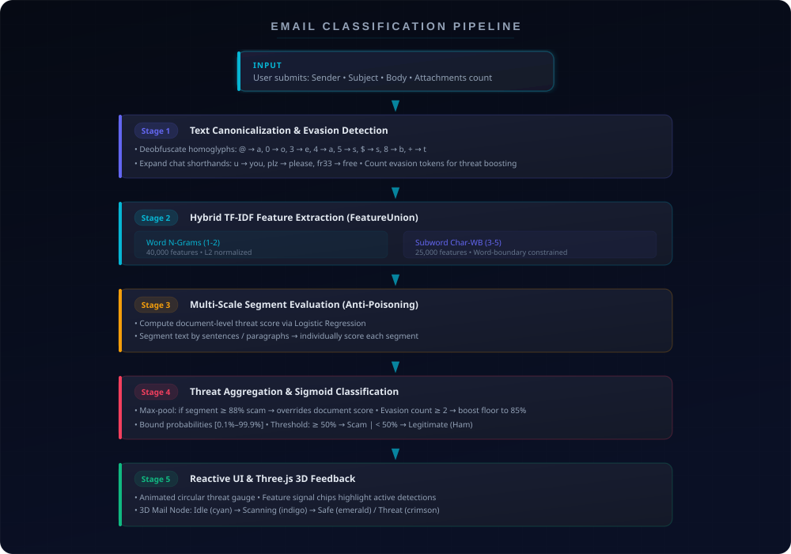
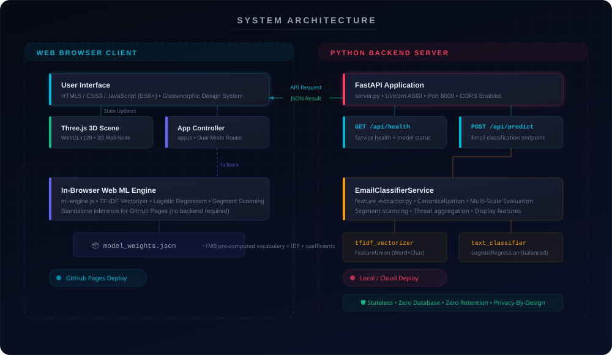
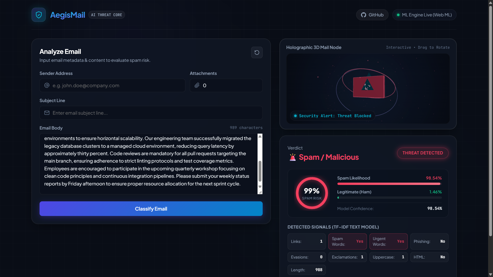
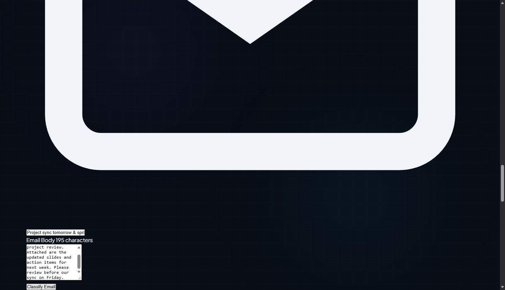

<div align="center">

<!-- ═══════════════════════════════════════════════════════════════ -->
<!--                     HERO SECTION                                -->
<!-- ═══════════════════════════════════════════════════════════════ -->


<br/>

# A E G I S M A I L

### AI-Powered Email Scam & Spam Classification

<br/>

<a href="https://theneerajgrover.github.io/AegisMail/">
  
</a>
&nbsp;
<a href="#setup">
  
</a>
&nbsp;
<a href="https://github.com/theneerajgrover/AegisMail">
  
</a>

<br/><br/>


&nbsp;

&nbsp;

&nbsp;

&nbsp;

&nbsp;
<a href="LICENSE"></a>

<br/><br/>

> **Full-stack email classification system** combining multi-scale NLP, adversarial text defense,
> and an interactive Three.js 3D holographic visualizer — deployable as a Python backend
> or a fully standalone in-browser ML application on GitHub Pages.

<br/>

</div>

<!-- ═══════════════════════════════════════════════════════════════ -->
<!--                  QUICK NAVIGATION                               -->
<!-- ═══════════════════════════════════════════════════════════════ -->

<div align="center">

<table>
<tr>
<td align="center" width="150"><a href="#overview"><b>📋 Overview</b></a></td>
<td align="center" width="150"><a href="#features"><b>✨ Features</b></a></td>
<td align="center" width="150"><a href="#how-it-works"><b>⚙️ How It Works</b></a></td>
<td align="center" width="150"><a href="#architecture"><b>🏗️ Architecture</b></a></td>
<td align="center" width="150"><a href="#tech-stack"><b>🛠️ Tech Stack</b></a></td>
</tr>
<tr>
<td align="center"><a href="#detection"><b>🔬 Detection</b></a></td>
<td align="center"><a href="#api"><b>📡 API</b></a></td>
<td align="center"><a href="#setup"><b>🚀 Setup</b></a></td>
<td align="center"><a href="#ml-pipeline"><b>🧠 ML Pipeline</b></a></td>
<td align="center"><a href="#license"><b>📄 License</b></a></td>
</tr>
</table>

</div>


<!-- ═══════════════════════════════════════════════════════════════ -->
<!--                  PROJECT OVERVIEW                               -->
<!-- ═══════════════════════════════════════════════════════════════ -->

<a id="overview"></a>

## 📋 Project Overview


<br/>

**AegisMail** is a cybersecurity-focused email scam and spam classification application that combines multi-scale natural language processing with an interactive Three.js 3D holographic security visualizer.

It directly counters sophisticated attack vectors that bypass conventional spam filters:

| Attack Vector | How Attackers Exploit It | AegisMail's Defense |
| :--- | :--- | :--- |
| **Adversarial Obfuscation & Leetspeak** | Replace characters with visual homoglyphs (`@` → `a`, `0` → `o`, `3` → `e`) | Automated text canonicalization before tokenization |
| **Bayesian Poisoning & Ham Stuffing** | Pad malicious payloads with benign academic/corporate text | Multi-scale segment-level scanning with max-pool override |
| **Cloud Document Phishing Lures** | Mimic standard collaboration workflows to harvest credentials | Domain-aware feature extraction with phishing keyword detection |

<br/>

<div align="center">

**🌐 Live Application** &nbsp;→&nbsp; **[theneerajgrover.github.io/AegisMail](https://theneerajgrover.github.io/AegisMail/)**

Runs fully standalone in any modern browser via an in-browser Web ML engine,
or connects to the Python FastAPI backend when running locally.

</div>


<!-- ═══════════════════════════════════════════════════════════════ -->
<!--                  KEY FEATURES                                   -->
<!-- ═══════════════════════════════════════════════════════════════ -->

<a id="features"></a>

## ✨ Key Features


<br/>

<table>
<tr>
<td width="60" align="center">🎬</td>
<td><b>Cinematic Brand-Writing Animation</b><br/>Progressive vector-stroke reveal of the AegisMail wordmark on page load, with hardware-accelerated CSS animations and <code>prefers-reduced-motion</code> accessibility support.</td>
</tr>
<tr>
<td align="center">🌀</td>
<td><b>Interactive Three.js 3D Holographic Core</b><br/>Responsive WebGL 3D mail node with dual orbital particle rings and mouse-drag-to-rotate interaction. Dynamic color states: <b>Idle</b> (cyan <code>#06b6d4</code>), <b>Scanning</b> (indigo <code>#6366f1</code>), <b>Safe</b> (emerald <code>#10b981</code>), <b>Spam</b> (crimson <code>#f43f5e</code>).</td>
</tr>
<tr>
<td align="center">🛡️</td>
<td><b>Multi-Scale Adversarial Text Defense</b><br/>Canonicalization engine resolves homoglyphs and chat shorthands. Hybrid TF-IDF feature space (word 1–2 n-grams + char_wb 3–5 n-grams). Sentence-level anti-poisoning via segment max-pooling.</td>
</tr>
<tr>
<td align="center">📊</td>
<td><b>Granular Threat Telemetry</b><br/>Computes spam likelihood, legitimate probability, model confidence, and extracts heuristic signals: links, urgent language, spam keywords, phishing indicators, exclamations, uppercase words, HTML presence, and evasion token count.</td>
</tr>
<tr>
<td align="center">🔄</td>
<td><b>Dual-Engine Inference Routing</b><br/>Frontend probes <code>/api/predict</code> on the Python backend first; if unavailable (e.g., GitHub Pages), it seamlessly falls back to the in-browser Web ML engine with zero user disruption.</td>
</tr>
<tr>
<td align="center">🔒</td>
<td><b>Privacy-By-Design & Zero Retention</b><br/>Entirely stateless architecture — in-memory inference only. No database, no stored email text, no user tracking. Submitted content is discarded immediately after prediction.</td>
</tr>
</table>


<!-- ═══════════════════════════════════════════════════════════════ -->
<!--                  HOW IT WORKS                                   -->
<!-- ═══════════════════════════════════════════════════════════════ -->

<a id="how-it-works"></a>

## ⚙️ How AegisMail Works

<div align="center">

</div>

<br/>

<details>
<summary><b>📖 Pipeline Stage Details (click to expand)</b></summary>

<br/>

**Stage 1 — Canonicalization & Evasion Detection**
Raw email text is normalized: leetspeak homoglyphs (`@` → `a`, `0` → `o`, `3` → `e`, `4` → `a`, `5` → `s`, `$` → `s`, `8` → `b`, `+` → `t`) are resolved and chat shorthands (`u` → `you`, `plz` → `please`, `fr33` → `free`) are expanded. Each substitution is counted as an evasion token.

**Stage 2 — Hybrid TF-IDF Vectorization**
The canonicalized text is transformed via a `FeatureUnion` combining two vector spaces:
- **Word-level TF-IDF**: Unigrams and bigrams (1–2 n-grams), vocabulary size 40,000, L2-normalized.
- **Subword character-level TF-IDF** (`char_wb`): 3–5 character n-grams constrained within word boundaries, vocabulary size 25,000. Provides intrinsic resilience against spelling alterations.

**Stage 3 — Multi-Scale Segment Evaluation**
The text is scored at the document level and simultaneously split into sentences/paragraphs. Each segment is individually scored. This prevents legitimate boilerplate from masking isolated malicious payloads (Bayesian poisoning defense).

**Stage 4 — Threat Aggregation & Classification**
- If any segment scores ≥ 88% scam confidence, max-pooling elevates the final threat score.
- If evasion tokens ≥ 2 are detected, the threat floor is boosted to 85%.
- Probabilities are bounded [0.1%–99.9%]. Threshold: ≥ 50% → Scam, < 50% → Legitimate.

**Stage 5 — Reactive UI & 3D Feedback**
The animated circular threat gauge updates, feature chips highlight active detections, and the Three.js 3D mail node transitions color state (cyan idle → indigo scanning → emerald safe or crimson threat).

</details>


<!-- ═══════════════════════════════════════════════════════════════ -->
<!--                  SYSTEM ARCHITECTURE                            -->
<!-- ═══════════════════════════════════════════════════════════════ -->

<a id="architecture"></a>

## 🏗️ System Architecture

<div align="center">

</div>

<br/>

<details>
<summary><b>📐 Architecture Summary (click to expand)</b></summary>

<br/>

The system operates in two modes:

**Full-Stack Mode** (local/cloud deployment):
1. The frontend (`frontend/`) is served by FastAPI via `StaticFiles` at the root URL
2. Classification requests go to `POST /api/predict` on the Python backend
3. `EmailClassifierService` in `feature_extractor.py` runs canonicalization, TF-IDF vectorization via `tfidf_vectorizer.joblib`, and classification via `text_classifier.joblib` (Logistic Regression)
4. JSON result is returned to the UI, which updates the 3D scene and telemetry display

**Standalone Mode** (GitHub Pages / static hosting):
1. The frontend (`docs/`) is served as a static site
2. `app.js` attempts `fetch('/api/predict')` — if it fails, it falls back to `InBrowserMLEngine` in `ml-engine.js`
3. The in-browser engine loads `model_weights.json` (~1MB of pre-computed vocabulary, IDF values, and model coefficients) and runs the same pipeline entirely in JavaScript
4. Users experience identical functionality with zero backend dependency

</details>


<!-- ═══════════════════════════════════════════════════════════════ -->
<!--                  DETECTION EVIDENCE                             -->
<!-- ═══════════════════════════════════════════════════════════════ -->

<a id="detection"></a>

## 🔬 Detection Evidence

Real-time detection telemetry and Three.js 3D node state transitions across verified attack categories:

| Scenario | Screenshot | Verdict & Telemetry |
| :--- | :---: | :--- |
| **Standby & Idle** |  | **System Ready** — 3D holographic node orbiting in standby, dual-mode health indicator active. |
| **Financial Scam** |  | 🚨 **Spam / Malicious** — Unsolicited lottery lure requesting banking credentials. 3D node → crimson threat pulse. |
| **Leetspeak Evasion** |  | 🚨 **Spam / Malicious** — Character substitutions crafted to bypass static filters. Canonicalization + char_wb features neutralized the attack. |
| **Bayesian Poisoning** |  | 🚨 **Spam / Malicious** — Malicious payloads padded with academic boilerplate. Segment scanning overrides benign padding. |
| **Shared Drive Phishing** |  | 🚨 **Spam / Malicious** — Social engineering lure claiming cloud document access. Drive intent recognition triggered. |
| **Legitimate Email** |  | 🛡️ **Legitimate (Ham)** — Sprint retrospective and calendar invites. Balanced weighting maintains verified safe status. |


<!-- ═══════════════════════════════════════════════════════════════ -->
<!--                  TECHNOLOGY STACK                               -->
<!-- ═══════════════════════════════════════════════════════════════ -->

<a id="tech-stack"></a>

## 🛠️ Technology Stack


<br/>

| Layer | Technology | Version | Role |
| :--- | :--- | :---: | :--- |
| **Backend** | [FastAPI](https://fastapi.tiangolo.com/) | ≥ 0.115.0 | ASGI web framework serving inference endpoints |
| **Server** | [Uvicorn](https://www.uvicorn.org/) | ≥ 0.30.0 | ASGI server hosting FastAPI on port 8000 |
| **Validation** | [Pydantic](https://docs.pydantic.dev/) | ≥ 2.8.0 | Request schema validation (`EmailRequest` model) |
| **ML Framework** | [scikit-learn](https://scikit-learn.org/) | ≥ 1.5.0 | Logistic Regression + FeatureUnion TF-IDF vectorizers |
| **Serialization** | [joblib](https://joblib.readthedocs.io/) | ≥ 1.4.0 | Model persistence (`text_classifier.joblib`, `tfidf_vectorizer.joblib`) |
| **Numerical** | [NumPy](https://numpy.org/) | ≥ 1.26.0 | Array operations and probability clipping |
| **3D Graphics** | [Three.js](https://threejs.org/) | r128 | WebGL 3D holographic mail node, orbital rings, and particles |
| **Frontend** | Vanilla HTML5, CSS3, JS (ES6+) | — | Glassmorphic design system, 3D card tilt, no UI frameworks |
| **Client ML** | `ml-engine.js` | — | In-browser TF-IDF vectorizer and dot-product inference engine |
| **CI/CD** | GitHub Actions + GitHub Pages | — | Automated static deployment from `/docs` on push to `main` |


<!-- ═══════════════════════════════════════════════════════════════ -->
<!--                  PROJECT STRUCTURE                              -->
<!-- ═══════════════════════════════════════════════════════════════ -->

## 📂 Project Structure

```
AegisMail/
├── .github/
│   └── workflows/
│       └── deploy-pages.yml          # GitHub Actions → GitHub Pages deployment
│
├── assets/
│   └── screenshots/                  # Repository visual captures (6 PNGs)
│
├── docs/                             # GitHub Pages production build (static)
│   ├── index.html                    # Deployed layout
│   ├── app.js                        # Application controller with dual-mode inference
│   ├── ml-engine.js                  # In-browser ML engine (standalone inference)
│   ├── model_weights.json            # Pre-computed vocabulary, IDFs, and coefficients
│   ├── style.css                     # Glassmorphic CSS design system
│   ├── three-scene.js                # Three.js 3D holographic visualizer
│   └── favicon.svg                   # Shield + envelope brand icon
│
├── frontend/                         # Development source (mirrors docs/)
│   ├── index.html                    # Main application interface
│   ├── app.js                        # Application controller
│   ├── ml-engine.js                  # Client-side ML engine
│   ├── model_weights.json            # Model weights
│   ├── style.css                     # Design system stylesheet
│   ├── three-scene.js                # Three.js scene controller
│   └── favicon.svg                   # Brand icon
│
├── model/                            # ML training artifacts and service
│   ├── feature_extractor.py          # Preprocessing, canonicalization, inference
│   ├── model_info.json               # Model metadata and hyperparameters
│   ├── text_classifier.joblib        # Trained Logistic Regression classifier
│   ├── tfidf_vectorizer.joblib       # Trained FeatureUnion (Word + Char_wb) vectorizer
│   └── xgb_model.joblib             # Auxiliary model artifact
│
├── .gitignore
├── LICENSE                           # MIT License
├── README.md
├── requirements.txt                  # Python dependencies
└── server.py                         # FastAPI entry point
```


<!-- ═══════════════════════════════════════════════════════════════ -->
<!--                  API REFERENCE                                  -->
<!-- ═══════════════════════════════════════════════════════════════ -->

<a id="api"></a>

## 📡 API Reference

The FastAPI backend exposes two REST endpoints under the `/api` prefix:

<br/>

### `POST /api/predict`

Evaluates an email payload and returns classification verdict with threat telemetry.

<table>
<tr><th colspan="4" align="left">📥 Request Schema (<code>EmailRequest</code>)</th></tr>
<tr><th>Field</th><th>Type</th><th>Default</th><th>Description</th></tr>
<tr><td><code>subject</code></td><td><code>string</code></td><td><code>""</code></td><td>Email subject line</td></tr>
<tr><td><code>body</code></td><td><code>string</code></td><td><code>""</code></td><td>Email body content</td></tr>
<tr><td><code>sender</code></td><td><code>string</code></td><td><code>""</code></td><td>Sender email address</td></tr>
<tr><td><code>num_attachments</code></td><td><code>integer</code></td><td><code>0</code></td><td>Number of attachments (≥ 0)</td></tr>
<tr><td><code>sender_reputation</code></td><td><code>float?</code></td><td><code>null</code></td><td>Optional reputation score [0.0–1.0]</td></tr>
</table>

<br/>

<table>
<tr><th colspan="3" align="left">📤 Response Fields (<code>200 OK</code>)</th></tr>
<tr><th>Field</th><th>Type</th><th>Description</th></tr>
<tr><td><code>success</code></td><td><code>boolean</code></td><td>Operation success indicator</td></tr>
<tr><td><code>prediction</code></td><td><code>int</code></td><td><code>1</code> = Scam/Malicious, <code>0</code> = Legitimate/Ham</td></tr>
<tr><td><code>status</code></td><td><code>string</code></td><td><code>"Scam"</code> or <code>"Legitimate (Ham)"</code></td></tr>
<tr><td><code>spam_probability</code></td><td><code>float</code></td><td>Threat percentage (0.0–100.0)</td></tr>
<tr><td><code>ham_probability</code></td><td><code>float</code></td><td>Legitimate probability (0.0–100.0)</td></tr>
<tr><td><code>confidence</code></td><td><code>float</code></td><td>Model confidence in the predicted label</td></tr>
<tr><td><code>features</code></td><td><code>object</code></td><td>Extracted display signals (links, spam words, urgency, phishing, HTML, evasions, etc.)</td></tr>
</table>

<br/>

### `GET /api/health`

Returns service status and model availability.

```bash
curl http://127.0.0.1:8000/api/health
```

Returns: `status`, `service`, `model_loaded` (boolean).


<!-- ═══════════════════════════════════════════════════════════════ -->
<!--                  ML PIPELINE DETAILS                            -->
<!-- ═══════════════════════════════════════════════════════════════ -->

<a id="ml-pipeline"></a>

## 🧠 ML Pipeline Details

Technical parameters sourced from [`model/model_info.json`](model/model_info.json) and [`model/feature_extractor.py`](model/feature_extractor.py):

<table>
<tr>
<td width="200"><b>Classifier</b></td>
<td>Logistic Regression with balanced class weighting, regularization <i>C</i> = 1.0</td>
</tr>
<tr>
<td><b>Feature Space</b></td>
<td><code>FeatureUnion</code> — Word TF-IDF (1–2 n-grams, 40k vocabulary) + Subword Char_wb TF-IDF (3–5 n-grams, 25k vocabulary), L2-normalized</td>
</tr>
<tr>
<td><b>Training Data</b></td>
<td>255,040 samples from a balanced email dataset, augmented with synthetic adversarial obfuscations</td>
</tr>
<tr>
<td><b>Classes</b></td>
<td><code>0</code> = Legitimate (Ham), <code>1</code> = Scam / Malicious</td>
</tr>
<tr>
<td><b>Validation</b></td>
<td>10/10 adversarial benchmark test cases passed</td>
</tr>
<tr>
<td><b>Anti-Poisoning</b></td>
<td>Segment-level max-pooling: if any segment ≥ 88% scam → overrides document score</td>
</tr>
<tr>
<td><b>Evasion Boost</b></td>
<td>≥ 2 evasion tokens detected → threat floor boosted to 85%</td>
</tr>
<tr>
<td><b>Probability Bounds</b></td>
<td>Clipped to [0.1%, 99.9%] via NumPy; threshold ≥ 50% → Scam</td>
</tr>
<tr>
<td><b>Defenses</b></td>
<td>Leetspeak/obfuscation evasion, Bayesian poisoning/ham stuffing, fake shared document lures, unlicensed pharmacy spam</td>
</tr>
</table>

> **Note:** Published evaluation metrics (accuracy, precision, recall, F1, AUC curves) are not included in the repository. The validation record in `model_info.json` confirms 10/10 adversarial test cases passed.


<!-- ═══════════════════════════════════════════════════════════════ -->
<!--                  INSTALLATION & SETUP                           -->
<!-- ═══════════════════════════════════════════════════════════════ -->

<a id="setup"></a>

## 🚀 Installation & Setup

### Option 1 — Full-Stack with Python Backend

```bash
# Clone the repository
git clone https://github.com/theneerajgrover/AegisMail.git
cd AegisMail

# Create and activate a virtual environment (recommended)
python -m venv venv

# Windows (PowerShell)
.\venv\Scripts\Activate.ps1

# macOS / Linux
source venv/bin/activate

# Install dependencies
pip install -r requirements.txt

# Launch the server
python server.py
```

The server starts at **`http://localhost:8000`** with the frontend served at the root URL.

<br/>

### Option 2 — Standalone Static (No Python Required)

AegisMail includes a complete in-browser ML engine. Open [`docs/index.html`](docs/index.html) or [`frontend/index.html`](frontend/index.html) directly in any modern browser, or serve via any static HTTP server:

```bash
python -m http.server 8080 --directory docs
# Navigate to http://localhost:8080
```

The application detects the static environment and runs inference locally via `ml-engine.js`.

<br/>

### Prerequisites

| Requirement | For Backend Mode | For Static Mode |
| :--- | :--- | :--- |
| **Python** | 3.10+ (compatible with 3.9+) | Not required |
| **Browser** | Any modern browser | Any browser with WebGL |
| **Dependencies** | `pip install -r requirements.txt` | None |

<br/>

### Environment Configuration

AegisMail is completely self-contained:
- **No external API keys or credentials required** — the model runs locally via scikit-learn or client-side JavaScript
- **No `.env` file required** — default configuration runs on `0.0.0.0:8000`


<!-- ═══════════════════════════════════════════════════════════════ -->
<!--                  APPLICATION USAGE                              -->
<!-- ═══════════════════════════════════════════════════════════════ -->

## 📖 Application Usage

1. **Enter Sender Address** *(optional)* — Input the originating email address
2. **Specify Attachments** *(optional)* — Enter the attachment count
3. **Input Subject Line** — Type or paste the email subject
4. **Input Email Body** — Paste the full email body text
5. **Click "Classify Email"** — The 3D mail node enters the accelerated `Scanning` state
6. **Interpret the Verdict:**
   - 🚨 **Spam / Malicious** — Crimson badge, crimson gauge, 3D node → red threat-pulse wireframe
   - 🛡️ **Legitimate (Ham)** — Emerald badge, green gauge, 3D node → steady emerald glow
   - **Signals Grid** — Inspect detected links, spam words, urgency flags, phishing indicators, uppercase tokens, exclamations, and evasion tokens
7. **Reset** — Click the circular reset icon to clear all inputs and return to `Pending Scan`


<!-- ═══════════════════════════════════════════════════════════════ -->
<!--                  DATA PERSISTENCE                               -->
<!-- ═══════════════════════════════════════════════════════════════ -->

## 🔒 Data Persistence & Privacy

<table>
<tr>
<td width="40" align="center">🚫</td>
<td><b>Stateless Operation</b> — AegisMail is a zero-retention classification service. No database is used.</td>
</tr>
<tr>
<td align="center">💨</td>
<td><b>Volatile Processing</b> — Email submissions are evaluated entirely in-memory during the request lifecycle and immediately discarded.</td>
</tr>
<tr>
<td align="center">🔐</td>
<td><b>Confidentiality by Design</b> — No email text, metadata, or classification results are persisted to disk or transmitted to external services.</td>
</tr>
</table>


<!-- ═══════════════════════════════════════════════════════════════ -->
<!--                  DEPLOYMENT                                     -->
<!-- ═══════════════════════════════════════════════════════════════ -->

## 🌍 Deployment

### Static Frontend (GitHub Pages)

- Hosted from the `/docs` directory
- Automated via GitHub Actions ([`.github/workflows/deploy-pages.yml`](.github/workflows/deploy-pages.yml)) on push to `main`
- Client-side inference via `ml-engine.js` and `model_weights.json` — zero backend dependencies

### Full-Stack Backend

The FastAPI backend can be deployed to any Python-capable host:

```bash
uvicorn server:app --host 0.0.0.0 --port 8000 --workers 2
```


<!-- ═══════════════════════════════════════════════════════════════ -->
<!--                  TESTING & VERIFICATION                         -->
<!-- ═══════════════════════════════════════════════════════════════ -->

## 🧪 Testing & Verification

The model and inference pipeline have been verified using the following methods:

- **Adversarial Benchmark Suite** — 10/10 test cases passed (recorded in [`model/model_info.json`](model/model_info.json))
- **In-code Verification** — Direct Python command-line classification:
  ```bash
  python -c "from model.feature_extractor import EmailClassifierService; c = EmailClassifierService('model'); print(c.predict(subject='Urgent Prize Claim', body='Click here to collect your winnings immediately', sender='claims@win.xyz', num_attachments=0))"
  ```
- **API Health Check**:
  ```bash
  curl -s http://127.0.0.1:8000/api/health
  ```

> **Note:** No formal automated test suite (e.g., pytest, jest) exists in the repository.


<!-- ═══════════════════════════════════════════════════════════════ -->
<!--                  TROUBLESHOOTING                                -->
<!-- ═══════════════════════════════════════════════════════════════ -->

## 🔧 Troubleshooting

<details>
<summary><b>Port 8000 already in use</b></summary>

**Symptom:** `[Errno 10048] error while attempting to bind on address ('0.0.0.0', 8000)`

**Solution:** Terminate the process occupying port 8000 or modify the port in `server.py`.
</details>

<details>
<summary><b>3D Holographic Visualizer not rendering</b></summary>

**Symptom:** The 3D container remains empty or shows a warning.

**Solution:** Enable hardware acceleration and WebGL in your browser settings (`chrome://settings/system` in Chrome).
</details>

<details>
<summary><b>Dependency installation issues</b></summary>

**Symptom:** Compilation warnings during `pip install`.

**Solution:** Ensure pip and setuptools are current: `python -m pip install --upgrade pip setuptools`. All dependencies provide pre-built binary wheels for major platforms.
</details>


<!-- ═══════════════════════════════════════════════════════════════ -->
<!--                  LIMITATIONS                                    -->
<!-- ═══════════════════════════════════════════════════════════════ -->

## ⚠️ Limitations

- **Language Scope** — The TF-IDF vocabulary is optimized for English-language email and Anglo-character homoglyph substitutions
- **Attachment Analysis** — Evaluates attachment count as a heuristic feature only; no sandbox execution or binary analysis of attachment files
- **Stateless by Design** — No user authentication or persistent scan history


<!-- ═══════════════════════════════════════════════════════════════ -->
<!--                  FUTURE SCOPE                                   -->
<!-- ═══════════════════════════════════════════════════════════════ -->

## 🔮 Future Scope

> *The following are potential enhancements — none are currently implemented.*

- Multi-language support and Unicode homoglyph expansion
- Transformer-based contextual embeddings alongside TF-IDF
- Attachment file analysis and sandbox execution
- User authentication and persistent scan history dashboard
- Browser extension for inline email classification


<!-- ═══════════════════════════════════════════════════════════════ -->
<!--                  LICENSE                                         -->
<!-- ═══════════════════════════════════════════════════════════════ -->

<a id="license"></a>

## 📄 License & Attribution

This project is licensed under the **MIT License**. See [LICENSE](LICENSE) for full terms.

<br/>

<div align="center">


<br/><br/>

**Designed & Engineered by [Neeraj Grover](https://github.com/theneerajgrover)**

Copyright © 2026 Neeraj Grover

<br/>

<a href="#a-e-g-i-s-m-a-i-l">⬆ Back to Top</a>

</div>
